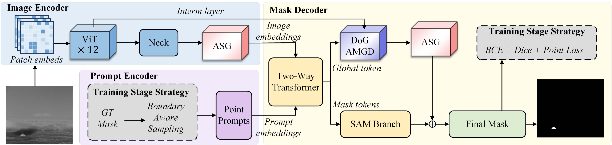
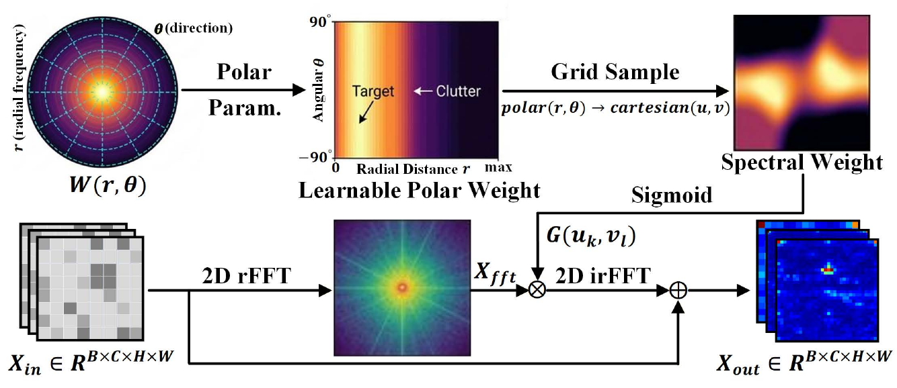
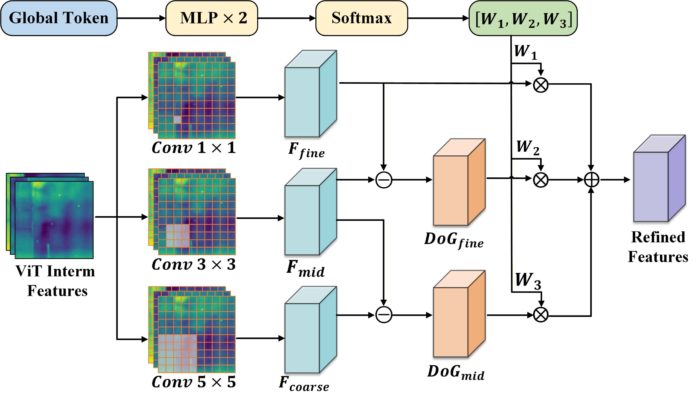

# ASG-SAM

Official core model implementation of **ASG-SAM: Anisotropic Spectral Gating
and Multigranularity Decoding for SAM-Based Infrared Small Target Segmentation**.

**Riyao Chen, Mingchao Yang, Zehao Wu, Tianming Xie, and Wenxiong Kang**

*IEEE Transactions on Geoscience and Remote Sensing (TGRS)*, vol. 64,
article 4707815, pp. 1-15, 2026.

[Paper / DOI](https://doi.org/10.1109/TGRS.2026.3737463)
| [Citation](#citation)
| [Model code](asg_sam/modeling)

## Overview

Infrared small targets occupy few pixels and are easily confused with
structured background clutter. ASG-SAM adapts EfficientSAM-ViT-Tiny to this
setting through polar-parameterized spectral modulation and adaptive detail
decoding. It preserves the original spatial token grid while improving
target-background separation and recovering weak target structures.



### Anisotropic Spectral Gating (ASG)

[ASG](asg_sam/modeling/asg.py) learns a channel-specific weight table jointly
indexed by radial and angular frequency. Bilinear sampling maps this polar
parameterization to the native, unshifted 2D rFFT grid. The gate modulates
spectral coefficients before inverse transformation and residual addition.
ASG is applied after the image-encoder neck and to the decoder detail feature.



### Difference-of-Gaussians Adaptive Multi-Granularity Decoder (DoG-AMGD)

[DoG-AMGD](asg_sam/modeling/decoder.py) recycles the intermediate feature from
the first ViT block. Three learnable branches produce fine-, middle-, and
coarse-granularity representations. Adjacent-granularity differences provide
DoG-style detail cues, and the global detail token predicts softmax routing
weights for adaptive fusion. The branches are trainable; the decoder does not
apply fixed Gaussian filters.



## Results Reported in the Paper

The following values are from Table I of the published article. mIoU, F1,
and detection probability Pd are percentages; false-alarm rate Fa is in
units of 10^-6.

| Dataset | mIoU | F1 | Pd | Fa |
| :--- | ---: | ---: | ---: | ---: |
| IRSTD-1K | 79.67 | 88.69 | 98.46 | 3.19 |
| NUAA-SIRST | 82.10 | 90.17 | 98.03 | 8.41 |
| IRSTDID-SKY | 84.84 | 91.80 | 98.95 | 0.31 |

## Release Contents

This release contains the model architecture and its supporting layers.
Training scripts, dataset loaders, evaluation pipelines, and weight files
are not included.

```text
asg_sam/
  __init__.py
  modeling/
    asg.py                  Polar-parameterized anisotropic spectral gate
    decoder.py              DoG-AMGD and mask decoder
    encoder.py              EfficientSAM-ViT-Tiny image encoder
    model.py                Model builder, forward interface, checkpoint loading
    prompt_encoder.py       Point-prompt encoding
    two_way_transformer.py  Image-prompt interaction
    mlp.py                  Shared MLP layers
assets/                     Architecture and module diagrams
CITATION.cff                Publication metadata
LICENSE                     Apache License 2.0
NOTICE                      Third-party attribution
```

## Installation

Python 3.10 or newer and PyTorch 2.1 or newer are required. Install the
appropriate PyTorch build for your CPU or CUDA environment first, then:

```bash
git clone https://github.com/SCUT-BIP-Lab/ASG-SAM.git
cd ASG-SAM
pip install -e .
```

## Model Usage

The model takes an image tensor and positive/negative point prompts. The
example below uses synthetic inputs to demonstrate the forward interface.
Without a checkpoint, the model is randomly initialized and its predictions
do not reproduce the published results.

```python
import torch

from asg_sam import build_asg_sam

device = torch.device("cuda" if torch.cuda.is_available() else "cpu")
model = build_asg_sam().to(device).eval()

# Image: [batch, channels, height, width]. One grayscale channel is
# broadcast to three channels by the model's normalization step.
image = torch.rand(1, 1, 256, 256, device=device)

# Points: [batch, queries, points, 2], in (x, y) input-image coordinates.
points = torch.tensor(
    [[[[128.0, 128.0], [32.0, 32.0], [224.0, 224.0]]]], device=device
)
# Labels: 1 = foreground, 0 = background, -1 = padding.
labels = torch.tensor([[[1, 0, 0]]], device=device)

with torch.inference_mode():
    mask_logits, iou_predictions, routing_weights = model(
        image, points, labels, return_routing=True
    )

print(mask_logits.shape)      # [1, 1, 1, 256, 256]
print(iou_predictions.shape)  # [1, 1, 1]
print(routing_weights.shape)  # [1, 1, 3]
probabilities = mask_logits.sigmoid()
```

Image tensors are resized internally to the encoder's 1024 x 1024 grid,
and point coordinates are scaled accordingly. Output masks default to the
input image resolution. Image values are passed to the model's built-in
normalization; any dataset-specific infrared preprocessing is the caller's
responsibility. Point prompts must also be supplied by the caller.

The default configuration uses 64 radial bins, 128 angular bins, and ASG
residual strengths of 1.0 on both encoder and decoder sides.

If you have a compatible ASG-SAM checkpoint locally, load its complete state
with:

```python
from asg_sam import load_checkpoint

load_checkpoint(model, "/path/to/asg_sam_checkpoint.pt", strict=True)
```

`build_asg_sam(pretrained="/path/to/efficient_sam_vitt.pt")` can instead
initialize shape-matched layers from an EfficientSAM-Ti checkpoint. The
additional ASG and DoG-AMGD layers still require task-specific learned
weights. The model builder does not download checkpoints.

## Citation

```bibtex
@article{chen2026asgsam,
  author  = {Chen, Riyao and Yang, Mingchao and Wu, Zehao and Xie, Tianming and Kang, Wenxiong},
  title   = {{ASG-SAM}: Anisotropic Spectral Gating and Multigranularity Decoding for {SAM}-Based Infrared Small Target Segmentation},
  journal = {IEEE Transactions on Geoscience and Remote Sensing},
  volume  = {64},
  pages   = {1--15},
  year    = {2026},
  doi     = {10.1109/TGRS.2026.3737463}
}
```

## Acknowledgments and License

This implementation builds on [EfficientSAM](https://github.com/yformer/EfficientSAM),
[Segment Anything](https://github.com/facebookresearch/segment-anything), and
[SAM-HQ](https://github.com/SysCV/sam-hq), together with their supporting
transformer components. See [NOTICE](NOTICE) for attribution.
Source code is distributed under the [Apache License 2.0](LICENSE).
